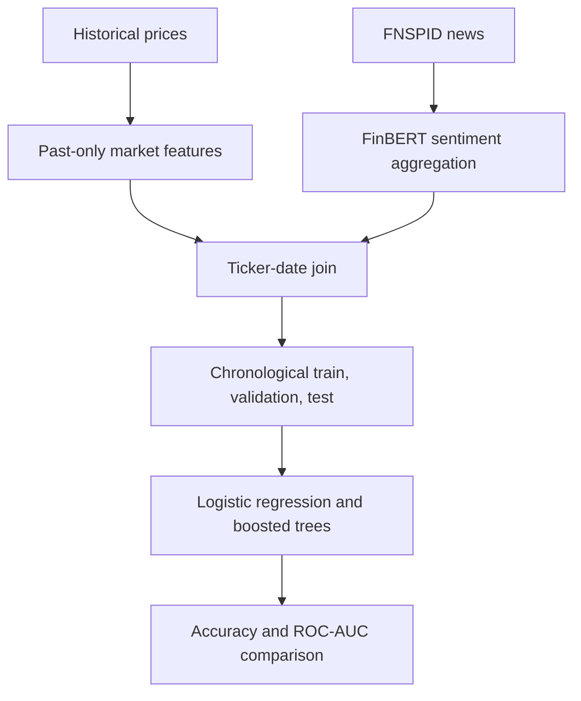

# Market Intelligence ML Pipeline

An experimental data-engineering and machine-learning pipeline comparing market-only features with market-plus-news sentiment for stock-direction classification. It is a research/learning project, not investment advice or a trading system.



## Quick offline demo

```sh
python -m venv .venv
source .venv/bin/activate
python -m pip install pandas numpy
python -m examples.smoke_demo
```

The demo calls the actual feature-engineering function on a synthetic 90-day price series; it performs no network downloads, makes no predictions about real stocks and excludes model benchmarking. Verified output: **90 input rows → 50 valid feature rows; PASS**. [Full smoke output](docs/smoke-demo.md).

## Full experimental workflow

Install the research dependencies with `python -m pip install -r requirements.txt`. These steps fetch large public data/model artifacts; confirm their licenses, storage and time budget first. Run from the repository root.

```sh
python -m app.ingestion.prices
python -m app.features.market_features
python -m app.ingestion.extract_fnspid
python -m app.features.news_features
python -m app.features.merge_news_market
python -m app.train_baseline
python -m app.train_tree
python -m app.train_horizons
```

The price importer defaults to NVDA, TSLA and AAPL (2011 to mid-2020), while the news extractor also includes MSFT and META. The available price/news overlap determines the joined cohort; the date/ticker merge is left-sided and explicitly handles missing news. Generated data and model files are not committed. FinBERT requires its model weights, and the full workflow has not been rerun in this documentation pass.

## Evaluation design

| Item | Definition |
| --- | --- |
| Training | Dates before 2018 |
| Validation | 2018 |
| Test | 2019 onward within downloaded range |
| Metrics | Accuracy and ROC-AUC |
| Horizons | 1-day and 5-day labels in horizon script |
| Results | No archived model scores are committed; report only actual new output |

Future-return fields are labels, not input features. Before claiming a predictive result, audit timestamp alignment and purge split-boundary rows whose label horizon crosses into the next partition. The smoke check validates feature construction only, not time-series generalization.

## Individual contribution
Yash Raj implemented price/news ingestion, chronological market feature generation, sentiment aggregation, ticker/date joins and baseline/tree comparison scripts. FinBERT and scikit-learn models are third-party libraries.
